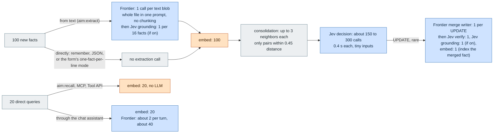
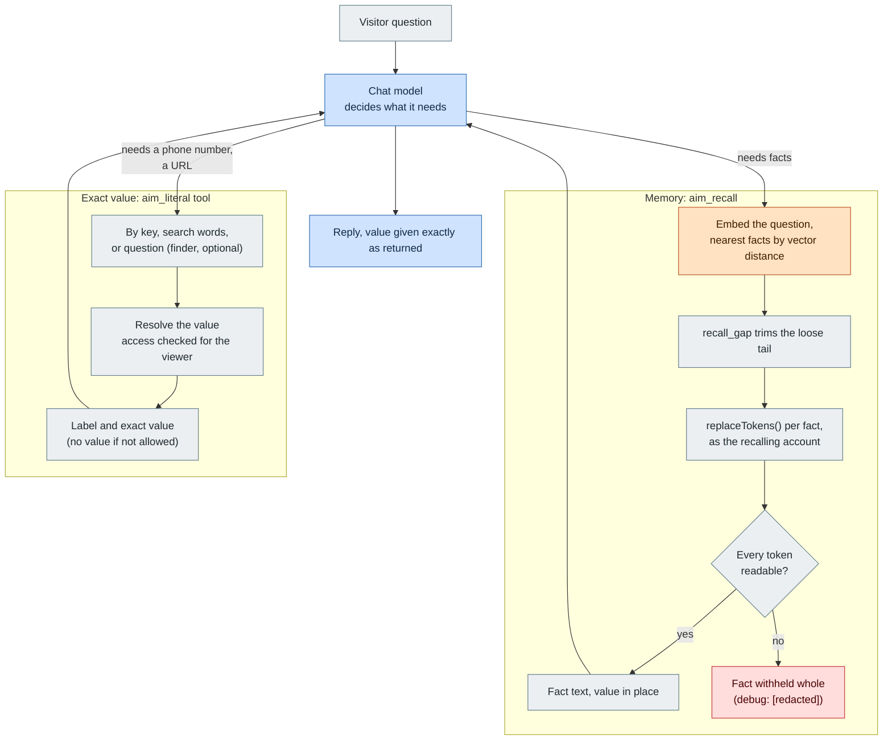
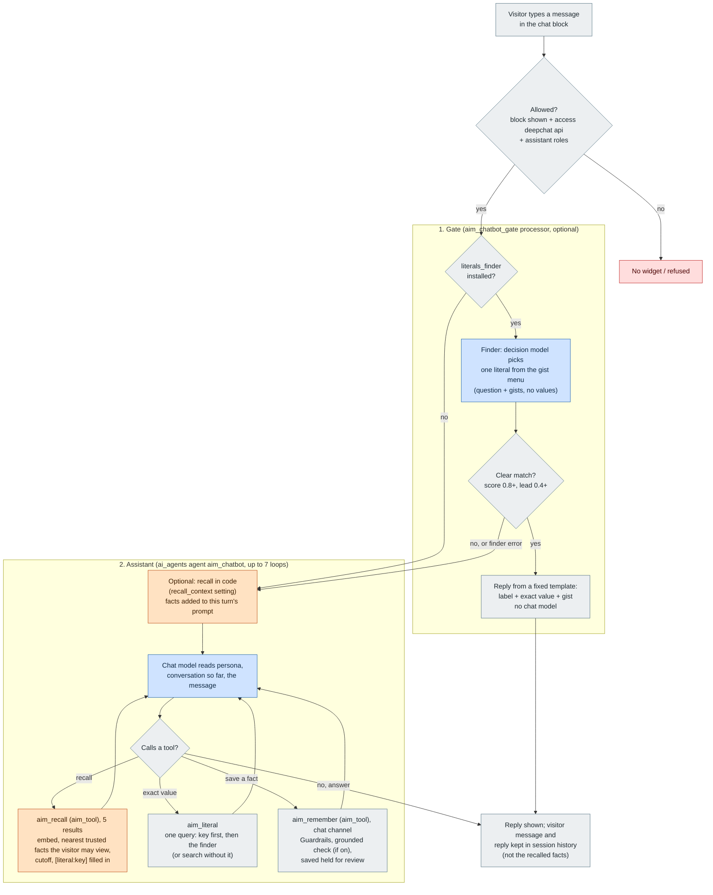

# AIM memory workflow diagrams

How a fact moves through the module, as the code stands on 2026-10-28
(`AimRememberService`, `AimGroundingChecker`, `AimTrustPolicy`,
`AimMemoryManager`, `AimConsolidationService`, `AimConsolidateQueueWorker`,
`AimRecallService`, `AimCommands`, `aim_tool`, `aim_chatbot`). Not a
decision record: for the reasoning see [0000-index.md](0000-index.md).

Six diagrams: write path (1), consolidation (2), recall (3), call
counts for a sample round (4), exact values (5), and one chat turn end
to end (6). The write path ends by enqueuing a fact for consolidation,
which is the hand-off into diagram 2. Diagram 3 reads what diagrams 1 and
2 left in the vector table.

Color key, used in every diagram:

- Blue, "LLM": a chat or decision model is called (can be remote).
- Orange, "Vector": embedding or vector math (an embeddings model call
  at index/query time, or MariaDB cosine distance in SQL).
- Gray, "Code": plain PHP, config or database logic, no model.
- Red: a rejection or dead end.

## 1. Write path: input to saved, queued and indexed fact

```mermaid
flowchart TD
  classDef llm fill:#cfe3ff,stroke:#2b6cb0,color:#102a43
  classDef vec fill:#ffe2c2,stroke:#c05621,color:#3d1f00
  classDef code fill:#eceff1,stroke:#607d8b,color:#1f2a30
  classDef bad fill:#fdd,stroke:#c53030,color:#4a0000

  subgraph IN["Write paths in (each names its trust channel in code)"]
    A1["drush aim:remember<br/>(single, or --file batch)<br/>used by agents such as Claude Code<br/>via the aim-memory skill<br/>channel drush, runs as anonymous"]
    A2["MCP / Tool API aim_remember<br/>needs 'remember aim facts' plus<br/>per-scope 'create {scope} aim facts'<br/>optional source_text from the caller<br/>channel mcp"]
    A3["Chat: the same aim_remember via tool_ai_connector<br/>scope by the visitor's permissions<br/>source_text from the assistant<br/>channel chat"]
    A4["drush aim:extract file<br/>aim-discovery skill runs this<br/>channel drush"]
    A5["Ingest form, extract mode<br/>prose .txt, needs 'ingest aim facts'<br/>channel ingest"]
    A6["Ingest form, lines or JSON mode<br/>no model call, rememberBatch()<br/>per-entry create check<br/>channel ingest, no source text"]
  end

  A1 --> R["AimRememberService::remember()"]
  A2 --> R
  A3 --> R
  A6 --> R

  A4 --> X
  A5 --> X["ingestText(): extractFacts()<br/>structured-output chat call<br/>(activities.extraction, else default chat)<br/>returns scope, subject, text list"]:::llm
  X --> C["createFactsFromCandidates()<br/>per candidate, one bad one<br/>does not abort the batch"]:::code
  C -->|"writer lacks 'create {scope} aim facts'<br/>(form user; Drush has no writer)"| DEN["denied, counted"]:::bad
  C -->|"scope requires an account<br/>and no --subject-uid"| SK["skipped, counted"]:::bad
  C --> GB["checkGrounding(document, all candidates)<br/>one decision call per 16 candidates<br/>(skipped when grounding_mode off)"]:::llm
  GB --> TP

  R --> R1{"scope is an enabled<br/>aim_scope?"}:::code
  R1 -->|no| ERR["InvalidArgumentException<br/>returned to caller"]:::bad
  R1 -->|yes| R2{"scope requires a<br/>real account?<br/>user scope, ADR-0007"}:::code
  R2 -->|"yes: subject must be a<br/>uid of a real user"| R3["resolve account<br/>no match: exception"]:::code
  R2 -->|"no, subject empty"| R4["scope plugin defaultSubject()<br/>e.g. case mints a case ID"]:::code
  R2 -->|"no, subject given"| R5["subject stored as given"]:::code
  R3 --> R6["build entity: text, source,<br/>category terms, asserted,<br/>target_type/target_id,<br/>expires (a past date: exception)"]:::code
  R4 --> R6
  R5 --> R6
  R6 --> GQ{"source text given and<br/>grounding_mode not off?"}:::code
  GQ -->|no| TP
  GQ -->|yes| GC["checkGrounding(source text, [text])<br/>decision model (activities.grounding),<br/>GROUNDING_QUESTION; a batch's score<br/>comes from the request cache"]:::llm
  GC --> TP

  TP["AimTrustPolicy::resolve(): starting trust<br/>writer canApprove() (administer aim, review aim facts,<br/>trust {scope} aim facts): trusted<br/>else channel rule, scope rule, default<br/>(empty: default_trusted). Shipped: chat = hold"]:::code
  TP --> TV{"AimTrustPolicy::values()<br/>grounding_mode?"}:::code
  TV -->|"off, or no source text"| TS["trusted = starting trust"]:::code
  TV -->|shadow| TSH["grounding_score stored,<br/>trusted = starting trust"]:::code
  TV -->|enforce| TE["grounding_score stored;<br/>at or above threshold (0.7): trusted,<br/>below or check failed: untrusted<br/>hold never promoted"]:::code
  TS --> EXP
  TSH --> EXP
  TE --> EXP
  EXP["explicit trusted from the caller wins:<br/>FALSE always, TRUE only if canApprove()"]:::code

  EXP --> V["saveFact(): $entity->validate()"]:::code
  V --> G["AimGuardrails constraint on text<br/>runGuardrails(): set aim_write_guardrails"]:::code
  G --> G1{"aggregated stop score<br/>reaches threshold 1.0?"}:::code
  G1 -->|"yes: aim_max_length 2000 chars,<br/>or aim_no_markup regex for HTML tags"| REJ["violation, InvalidArgumentException<br/>nothing saved<br/>warning logged without text<br/>remember: error to caller<br/>extract: counted as blocked"]:::bad
  G1 -->|no| SAVE["entity save()<br/>audit lines: write, and grounding<br/>(ID, score, cutoff, mode, no text)"]:::code

  SAVE --> H["hook_aim_fact_insert<br/>skipped when entity is syncing"]:::code
  H --> Q["enqueue fact ID on queue aim_consolidate<br/>see diagram 2"]:::code
  SAVE --> T["Search API tracker marks item<br/>for (re)index"]:::code
  T --> IDX{"index_directly?<br/>shipped: off, this site: on"}:::code
  IDX -->|on| EMB
  IDX -->|"off: cron_limit 50<br/>or drush sapi-i, or the<br/>queue worker's reindex()"| EMB
  EMB["aim_exclude_retired processor<br/>drops facts with retired set<br/>(plain code)"]:::code --> EMB2["embed field text only<br/>(main_content) via the<br/>server's embeddings engine"]:::vec
  EMB2 --> VT["row in aim_fact_vectors<br/>MariaDB VECTOR column, HNSW index<br/>M=16, ef_search=100<br/>attributes stored beside the vector:<br/>scope, subject, source, user, trusted"]:::vec
```

Notes on diagram 1:

- The ingest form has three modes: prose goes through extraction (one
  chat call per file, the model picks scope and subject, then one
  grounding call per 16 candidates against the whole file); one fact per
  line and JSON (the `aim:remember --file` shape, for case IDs and entity
  targets) skip the model and have no source text, so they stay
  unchecked.
- The grounded check sends the source text to the decision model and
  never stores it (ADR-0037). This site runs `shadow`: scores are
  recorded, `trusted` is left to the policy.
- Indexed fields: `text` is the embedded content. `scope`, `subject`,
  `source`, `user` and `trusted` are stored as attributes. The filterable
  ones used by code are `scope`, `subject`, `user` (BTREE index) and
  `trusted` (BTREE index). `source` is stored but no code filters on it.
  `retired` facts are removed by the processor; `expires` is not indexed
  (recall withholds a past-due fact, and `aim:expire` retires it).
- Guardrails here are deterministic (regexp plus length). The set has no
  LLM-backed guardrail, so the gate makes no model call.
- A rewriting guardrail would replace the text before save; none ships.

## 2. Consolidation: queue to retired or merged facts

```mermaid
flowchart TD
  classDef llm fill:#cfe3ff,stroke:#2b6cb0,color:#102a43
  classDef vec fill:#ffe2c2,stroke:#c05621,color:#3d1f00
  classDef code fill:#eceff1,stroke:#607d8b,color:#1f2a30
  classDef bad fill:#fdd,stroke:#c53030,color:#4a0000

  QI["queue aim_consolidate<br/>item = fact ID<br/>drained by dedicated crontab:<br/>drush queue:run aim_consolidate<br/>(no cron key, not hook_cron)"]:::code
  QI --> W1{"fact still exists<br/>and not retired?"}:::code
  W1 -->|no| DONE0["return, nothing to do"]:::bad
  W1 -->|yes| W2["reindex() so the fact and<br/>its neighbors are searchable"]:::vec
  W2 --> W3{"consolidation model?<br/>activities.consolidation,<br/>else default chat"}:::code
  W3 -->|none| SUSP["SuspendQueueException<br/>queue stops, item released"]:::bad
  W3 -->|yes| N

  MAN["drush aim:consolidate<br/>sweeps all non-retired facts by ID,<br/>each pair once;<br/>--dry-run computes decisions, saves nothing"]:::code --> N

  N["findNeighbors(), up to neighbor_limit (3)<br/>embed this fact's text as a query<br/>(query-embedding cache applies)<br/>filter scope, plus user or subject<br/>skip self, handled, retired,<br/>or a different end date (expires);<br/>each neighbor decided in turn,<br/>stop if this fact retires"]:::vec
  N --> N1{"neighbor found?"}:::code
  N1 -->|no| DONE1["done, no change"]:::code
  N1 -->|yes| S{"cosine distance<br/>score"}:::vec
  S -->|"above 0.45<br/>compare_distance"| SKIP["unrelated: skip, zero cost"]:::code
  S -->|"identical text<br/>(case, spacing, final full stop ignored)"| AUTO["decision NOOP, no model call<br/>keeps the older fact"]:::code
  S -->|"up to 0.45, any other text"| CL["classifyPair()<br/>kept = lower ID, candidate = higher ID<br/>decision backend (this site: Jev): one choice<br/>chat backend: one structured call<br/>returning decision and merged text"]:::llm

  CL --> D{"decision"}:::llm
  D -->|ADD| ADD["both stand, no change"]:::code
  D -->|NOOP| NOOP["decision NOOP"]:::code
  D -->|RETIRE| DEL["decision RETIRE"]:::code
  D -->|UPDATE| MT["merged text<br/>chat backend: from the same reply<br/>decision backend: writeMerge(), default<br/>chat model with merge_prompt<br/>(no default chat model: ADD)"]:::llm

  MT --> MG["runGuardrails(merged text)"]:::code
  MG -->|rejected| BLK["BLOCKED: both facts untouched<br/>warning logged"]:::bad
  MG -->|passed| VM["verifyMerge()"]:::code
  VM --> VM1{"merge_max_distance > 0?<br/>shipped 0 = off"}:::code
  VM1 -->|"on: embed merged text and<br/>both inputs, cosine distance<br/>over the max fails"| FAIL
  VM1 --> VM2{"merge_verify on?<br/>shipped: on"}:::code
  VM2 -->|"yes: verifier (activities.verifier,<br/>else the classifier's model)<br/>asked: every detail kept, nothing added?<br/>decision: noul 'faithful' at threshold<br/>(0.8 on this site)"| VM3["faithful or not"]:::llm
  VM3 -->|"not faithful, or error"| FAIL["merge rejected:<br/>downgrade UPDATE to ADD<br/>both facts stand, audit line<br/>(check: distance, model, error<br/>or grounding)"]:::bad
  VM3 -->|faithful| GM
  VM2 -->|no| GM
  GM{"grounding_mode?"}:::code
  GM -->|off| UPD["UPDATE accepted"]:::code
  GM -->|"shadow or enforce"| GR["groundMerge(): checkGrounding()<br/>passage = kept text, newline, candidate text<br/>candidate = merged text<br/>decision model, audit line"]:::llm
  GR --> GE{"enforce, and score below<br/>threshold (0.7) or no score?"}:::code
  GE -->|yes| FAIL
  GE -->|"no (shadow: always)"| UPD

  NOOP --> RN
  AUTO --> RN
  DEL --> RD
  UPD --> RU

  RN["retire candidate:<br/>retired = now<br/>superseded_by = kept fact<br/>superseded_by_reason = JSON"]:::code
  RD["soft retire candidate:<br/>retired = now<br/>superseded_by stays empty<br/>superseded_by_reason = JSON"]:::code
  RU["createMergedFact(): new fact via saveFact<br/>(guardrails run again)<br/>owner and identity from kept fact,<br/>asserted from candidate only,<br/>source candidate else kept,<br/>categories unioned, expires kept,<br/>trusted only if both inputs trusted,<br/>grounding_score = the merge's score<br/>then retire BOTH inputs:<br/>retired = now, superseded_by = merged fact<br/>reason JSON stored on candidate"]:::code

  RN --> IX["retired fact re-tracked: next index run<br/>removes it from aim_fact_vectors<br/>(aim_exclude_retired)"]:::vec
  RD --> IX
  RU --> IX
  RU --> NEWQ["merged fact insert enqueues<br/>itself on aim_consolidate"]:::code
  NEWQ -.-> QI

  SWEEP["drush aim:expire (crontab),<br/>hook_cron as backup:<br/>retired = now once expires passes<br/>no model call"]:::code --> IX

  JR["superseded_by_reason JSON:<br/>decision, by auto or model, score,<br/>provider, model ID<br/>never fact text"]:::code
  RN -.-> JR
  RD -.-> JR
  RU -.-> JR
```

Notes on diagram 2:

- Distances are cosine distances, lower is closer: "at or below"
  means more similar. The default 0.45 lives in
  `AimSettings::DEFAULT_COMPARE_DISTANCE`; the live value comes from
  `aim.settings` (`compare_distance`). There is no distance below which
  pairs merge unchecked (removed 2026-10-27, ADR-0036's addendum).
- A merge passes three checks in order: guardrails (policy), the
  verifier (both inputs' details survive, nothing added) and the
  grounded check (the inputs state the merge). Only the grounded check
  leaves a trace on the result, as `grounding_score`. In `enforce` a
  failed grounding keeps both facts rather than merging into an
  untrusted fact, which would retire two good facts for one doubtful one.
- Retirement is always soft. Nothing is deleted from `aim_fact`, and a
  retired fact can be un-retired by the admin action.
- `ADD` and `BLOCKED` change nothing, and the same pair is simply
  evaluated again on a later sweep.
- The queue and the sweep both call the same `decideAndApply()`.

## 3. Recall: query to returned facts

```mermaid
flowchart TD
  classDef llm fill:#cfe3ff,stroke:#2b6cb0,color:#102a43
  classDef vec fill:#ffe2c2,stroke:#c05621,color:#3d1f00
  classDef code fill:#eceff1,stroke:#607d8b,color:#1f2a30
  classDef bad fill:#fdd,stroke:#c53030,color:#4a0000

  C1["drush aim:recall<br/>max distance only if --max-distance given,<br/>no gap, access check off"]:::code
  C2["MCP / Tool API aim_recall<br/>needs 'recall aim facts'<br/>scope=user with no user:<br/>defaults to the calling account<br/>recall_max_distance and recall_gap,<br/>access checked as the caller"]:::code
  C3["Chat assistant: the same aim_recall<br/>via tool_ai_connector, as the visitor<br/>(ADR-0062)"]:::code

  C1 --> RC
  C2 --> RC
  C3 --> RC

  RC["AimRecallService::recall()"]:::code --> I{"aim_vector_index exists?"}:::code
  I -->|no| E1["RuntimeException"]:::bad
  I -->|yes| U{"subject-uid given and<br/>resolves to a user?"}:::code
  U -->|"given, no such user"| E2["InvalidArgumentException"]:::bad
  U -->|"ok or not given"| F["build query with keys = query text<br/>conditions: scope, subject, user,<br/>trusted = TRUE unless include-untrusted<br/>range: limit, or limit x 5 when user-filtered"]:::code

  F --> EX["executeSearchQuery()<br/>access check off (drush, consolidation):<br/>search_api_bypass_access on"]:::code
  EX --> EC{"query embedding cached?<br/>key: provider, model, config, text<br/>TTL 7 days, query time only"}:::vec
  EC -->|miss| EM["embed query text<br/>embeddings model call"]:::vec
  EC -->|hit| KNN
  EM --> KNN["MariaDB VEC_DISTANCE_COSINE over<br/>aim_fact_vectors, HNSW, pre-filtered<br/>by attribute conditions<br/>rows come back nearest first"]:::vec

  KNN --> PR["per result row"]:::code
  PR --> P1{"access checked?<br/>ai_search checks entity view access<br/>on each result: per-scope<br/>'view {scope} aim facts', user-scope<br/>role matrix, entity-scope plugin"}:::code
  P1 -->|"no access"| DROP["result dropped"]:::bad
  P1 -->|"allowed, or bypassed"| P2{"distance above<br/>max distance?"}:::vec
  P2 -->|yes| DROP
  P2 -->|no| P3{"entity still exists?<br/>(stale index row)"}:::code
  P3 -->|no| DROP
  P3 -->|yes| P4{"retired since the last index run,<br/>or expires already passed?"}:::code
  P4 -->|yes| DROP
  P4 -->|no| P5{"replaceTokens(): every<br/>[literal:key] readable<br/>by this viewer?"}:::code
  P5 -->|"no: withheld whole<br/>(show_redacted_facts: [redacted])"| DROP
  P5 -->|yes| OUT["row: id, score (distance),<br/>scope, subject, text with values in,<br/>source, trusted, created, asserted"]:::code
  OUT --> LIM{"limit reached?"}:::code
  LIM -->|yes| GAP
  LIM -->|no| PR
  GAP{"gap set?"}:::code
  GAP -->|"yes: drop rows farther than<br/>best score + gap"| RET["return rows"]:::code
  GAP -->|no| RET
```

Notes on diagram 3:

- Recall makes no chat-model call. The only model involved is the
  embeddings model, and only on a cache miss.
- Score is a distance: 0 is identical. The default cutoff is 0.48 in
  code; this site uses 0.60 with no gap (demo/README.md's "Model
  settings").
- `recall()` checks access by default: per-result access is enforced
  inside Search API's ai_search backend. Only Drush and consolidation
  pass `accessCheck: FALSE`.
- Untrusted facts are excluded by the `trusted = TRUE` condition unless
  `--include-untrusted` is passed (no Tool API or chat path passes it).

## Legend (plain English)

- **Write path.** Everything funnels into one of two PHP methods in
  `AimRememberService`. `remember()` stores exactly what a caller hands
  it (CLI, MCP tool, chat tool, the ingest form's lines and JSON modes);
  no model decides what is worth keeping. Extraction (`aim:extract`, the
  ingest form's prose mode) is the only path where a model reads source
  text and proposes facts, and those candidates then go through the same
  checks and save step. The aim-discovery skill ("the grill") is not a
  separate path: it interviews, writes a notes file, and runs
  `aim:extract` on it.
- **Grounded check.** When the text a fact came from is supplied, a
  decision model is asked whether that text states the fact, and the
  answer is stored as `grounding_score`. The source text is not kept.
- **Trusted.** A new fact's starting trust comes from the trust policy:
  trusted for a writer who could trust it by hand, else the entry
  channel's rule (chat is held for review), the scope's rule, then the
  default. In `enforce` mode the grounded check then promotes or demotes
  it (never a held fact). Recall hides untrusted facts by default.
- **Guardrails.** A fact is validated as an entity field constraint on
  `text` before it is saved. The shipped rules are a 2000 character cap
  and a no-HTML-tags pattern. A failure saves nothing; a single-fact
  caller gets an error, an extraction batch just counts it as blocked and
  carries on.
- **Indexing.** Saving a fact marks it for indexing. Its text is turned
  into an embedding and stored with a few filterable attributes in
  `aim_fact_vectors`. Retired facts are removed from that table.
- **Consolidation.** Runs later, off the request path, one queue item per
  new fact. Same-scope nearest neighbors with the same end date, by
  cosine distance: identical text is retired without a model, anything
  else close enough asks a model to choose ADD (keep both), NOOP
  (restatement), RETIRE (should not exist) or UPDATE (merge into a new
  fact). A merge must pass the guardrails, the verifier and, when it is
  on, the grounded check, or it falls back to keeping both.
- **Retire.** Setting `retired` (and where there is a replacement,
  `superseded_by`) hides a fact from recall and the index without
  deleting it. `superseded_by_reason` records how and by what it was
  decided, with no fact text. A fact whose `expires` date passes is
  retired the same way by `aim:expire`.
- **Recall.** Embed the query (cached), find nearest vectors with
  attribute filters, then drop anything the caller may not see, is too
  far away, is retired, past its end date, gone missing or names a value
  the caller may not read; finally trim the loose tail with the gap.

## 4. Calls per round: 100 new facts and 20 direct queries

Estimates from the code and one dry run (63 facts gave 94 consolidation
decisions, about 1.5 per fact), not a measurement. "Frontier" is the
frontier chat model (the site default chat model); "Jev" is whichever
decision backend `activities.consolidation` and `activities.verifier`
use; "embed" is the local embeddings model.

Notes on diagram 4:

- **Extraction is one call per input, not per fact.** `aim:extract` reads
  the whole file into one prompt (no chunking), so a file larger than the
  frontier model's context fails; split big files first.
- **Jev limits** (secondhand, from TypeSafe's public docs summary, not
  verified against the live API): 64k context, 32k tokens for the state
  plus the longest question; 40 requests/s and 100k tokens/s. A pair of
  facts is about 100 tokens (a fact is capped at 2000 characters by the
  write guardrail, about 500 tokens), far inside every limit.
- Cost: Jev is $0.042 per million input tokens, so 300 calls are well
  under a cent; the amazeeio frontier model is free.

## 5. Exact values: how a literal reaches an answer

Memory recall and exact values are separate. Recall finds facts; the
assistant calls a lookup tool when it needs an exact value. The value
always comes from the `literals` store, read as the person asking.

Read it this way:

- **The chat model chooses.** It decides whether a question needs a
  value lookup, so nothing calls a decision model on every recall. (The
  separate finder-first gate, which can answer before the chat model runs,
  is in diagram 6.)
- **Nothing is copied.** The value lives in the literal; a fact holds at most
  a token, so editing the literal changes every answer with no reindex.
- **Who sees what is decided at read time**, by the person asking.
- **The finder is optional.** It only maps a loose question to a literal for
  the tool's `question` mode; key and search-word lookups need no model.

## 6. One chat turn, end to end

What happens between a visitor typing in the chat widget and the reply,
with the demo recipe's settings. Each box says which module does it.

Read it this way:

- **Two stages, and the first is optional.** The gate only exists when the
  block's chat processor is `aim_chatbot_gate` and `literals_finder` is
  installed. It answers "what's your phone number?" questions on its own,
  with one small decision call and no chat model, and hands anything it is
  unsure of to the assistant. Without the finder it passes everything on.
- **The assistant is a loop.** The chat model either answers or asks for a
  tool; each tool result goes back to it, up to 7 rounds. Recall is not
  forced (`require_usage` off): the persona asks it to recall first, and
  forcing it made correct answers get thrown away.
- **Three tools, three jobs.** Recall finds remembered facts (memory).
  `aim_literal` fetches an exact value (the `literals` store). Remember
  saves something the visitor said, as an untrusted fact a reviewer
  approves.
- **Exact values never come from the model's memory.** They come from a
  literal: through the gate's template, a `[literal:key]` token in a
  recalled fact, or `aim_literal`. All three read as the visitor, so a
  restricted value stays hidden from someone not allowed to see it.
- **Models involved:** the chat model (amazee here) for the assistant;
  Ollama embeddings for recall and for indexing a saved fact; the decision
  model (Jev) for the finder and the grounded check. A remembered fact is
  later queued for consolidation (diagram 2), off the request path.
