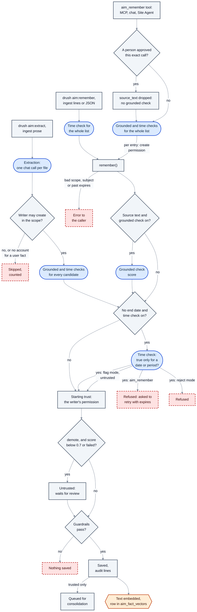
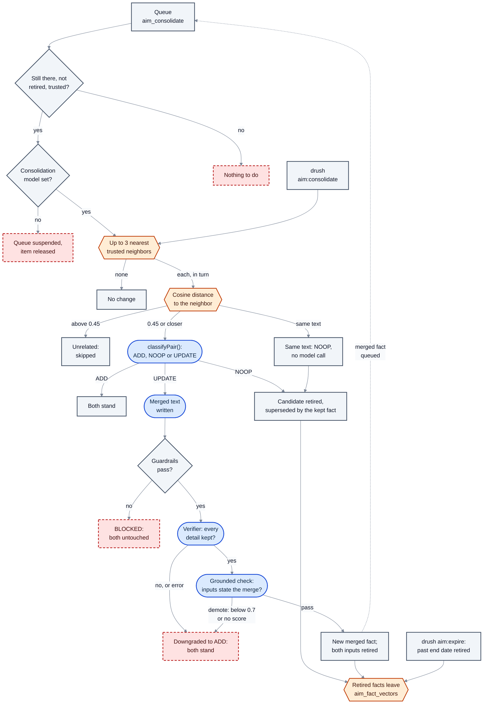
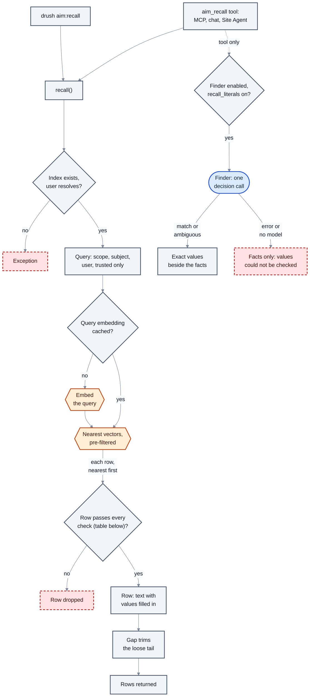
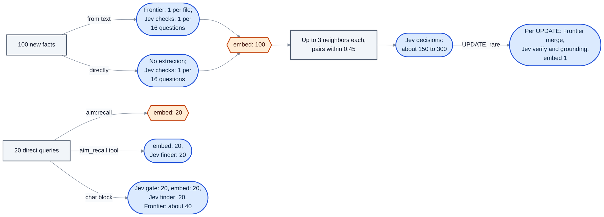
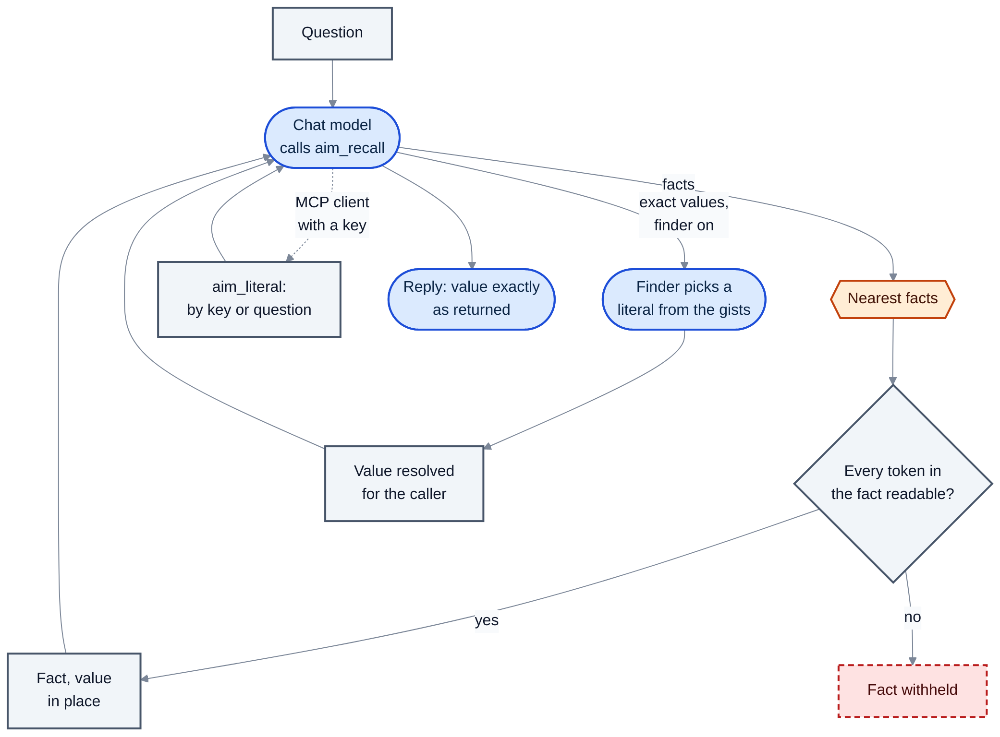
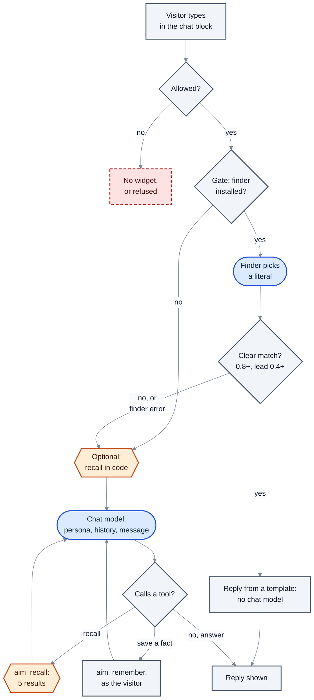
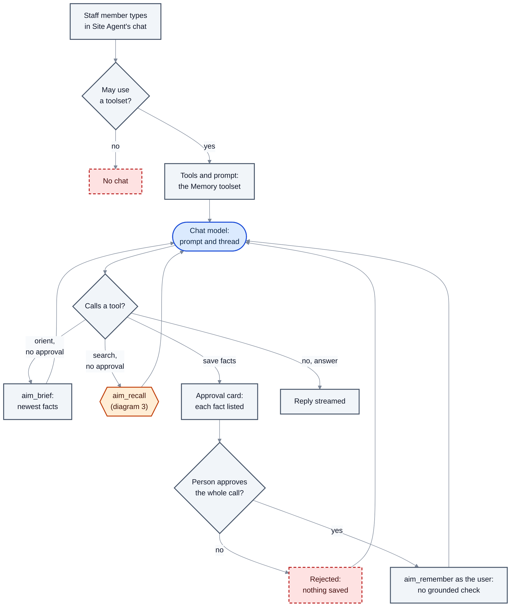

# AIM memory workflow diagrams

How a fact moves through the module, as the code stands on 2026-11-16
(`AimRememberService`, `AimGroundingChecker`, `AimFactAccessControlHandler`,
`AimMemoryManager`, `AimConsolidationService`, `AimConsolidateQueueWorker`,
`AimRecallService`, `AimCommands`, `AimHooks`, `aim_tool`, `aim_chatbot`,
`aim_site_agent`). Not a decision record: for the reasoning see
[0000-index.md](0000-index.md).

Seven diagrams: saving a fact (1), consolidation (2), recall (3), calls
for a sample round (4), exact values (5), one chat turn (6) and one Site
Agent turn (7). Saving ends by queueing a fact for consolidation (diagram
2); recall reads what both left in the vector table. Each diagram keeps
its boxes short; the detail is in the notes under it.

## Key

Each kind of box has its own shape and border as well as its own color, so
the key does not depend on color alone:

| Shape | Color | Means |
| --- | --- | --- |
| Rounded pill, solid blue border | Blue | A chat or decision model is called (can be remote) |
| Hexagon, solid orange border | Orange | Embedding or vector math: an embeddings model call, or MariaDB cosine distance in SQL |
| Rectangle, solid gray border | Gray | Plain PHP, config or database logic, no model |
| Diamond | Gray | A yes/no or multi-way check in code |
| Rectangle, dashed red border | Red | A rejection or dead end |

How the diagrams are drawn: each starts with an `init` line that fixes its
colors, so it looks the same in a light or dark viewer, and keeps the text
at full size (a diagram too wide for the page scrolls sideways rather than
shrinking). Every text color meets WCAG AA contrast (4.5:1) on its box.
Copy the `init` line and the four `classDef` lines when adding a diagram.

## 1. Saving a fact

The ways in:

| Path | Runs as | Source text | `source` recorded |
| --- | --- | --- | --- |
| `drush aim:remember --uid` (one fact, or `--file`), used by agents such as Claude Code through the aim-memory skill | the `--uid` account | none | `--source`, or the entry's own |
| Ingest form, one fact per line or JSON (`ingest aim facts`) | the form's user | none | the form's |
| `aim_remember` over MCP or Tool API (`remember aim facts`) | the token's user | optional `source_text` | `tool:aim_remember` |
| `aim_remember` in the chat block, through `tool_ai_connector` | the visitor | from the assistant | `chat:aim_remember` |
| `aim_remember` in Site Agent's chat, through the Memory toolset (diagram 7) | the thread's user | from the model | `site_agent:aim_remember` |
| `aim_remember` through Tool API's Drush invoker | the Drush user | optional | `drush:aim_remember` |
| `drush aim:extract FILE --uid` (the aim-discovery skill runs it), ingest form prose mode | the `--uid` account, the form's user | the whole file | the command's or form's |

Notes on diagram 1:

- **Two methods.** Every path ends in `AimRememberService::remember()`,
  which stores exactly what it is handed, or in
  `createFactsFromCandidates()`, which saves what extraction proposed. The
  `aim_remember` tool and `rememberBatch()` (Drush, the ingest form's lines
  and JSON modes) check the writer's `create {scope} aim facts` per entry;
  one bad entry is reported and skipped, never aborting the rest.
- **`source`** on `aim_remember` facts follows the Tool API invoker
  (`AimRemember::CALLERS`), not the caller's say. It records provenance
  only; trust comes from the writer's permissions.
- **A person approved this exact call?** Site Agent marks a call that ran
  after its approval card was approved, or that the thread's owner ran
  directly. `AimRemember` then drops `source_text`, so the grounded check
  does not run, and writes an audit line (ADR-0067). The time check, the
  writer's permissions and the guardrails still apply. The mark comes from
  this site's patch to site_agent
  (`patches/site_agent-person-approved-invoker.patch` at the site root);
  without it every call is grounded.
- **Batched checks.** Decision calls are made per write, not per fact:
  `checkBatch()` (the tool, `rememberBatch()`) and `checkGrounding()`
  (extraction) ask one question per candidate per check that is on, up to
  16 questions per call (`activities.grounding.max_questions`): 16
  candidates, or 8 with both checks on. `remember()` then finds its scores
  in the request cache.
- **Extraction.** `extractFacts()` makes one structured-output chat call
  per file (`activities.extraction`, else the default chat model); the
  model picks each candidate's scope and subject. A user-scope candidate
  needs `--subject-uid` (or the form's account), or it is skipped. A
  candidate a check or guardrail refuses is counted as blocked, and the
  rest carry on.
- **remember()** refuses a disabled or unknown scope, a user fact whose
  subject is not a real account (ADR-0007) and an `expires` already past.
  For other scopes the scope's plugin resolves the subject on save
  (`resolveSubject()`; the case plugin names or mints a case ID).
- **Grounded check** (ADR-0037): the decision model is asked whether the
  source text states the fact, and the answer is stored as
  `grounding_score`; the source text is never stored. It runs when
  `grounding_mode` is `record` or `demote` and a decision model is set for
  `activities.grounding`. This site runs `demote`: a score below 0.7, or a
  check that failed, saves the fact untrusted. The check never trusts a
  fact (ADR-0065).
- **Time check** (ADR-0057's addendum, `time_check_mode`, shipped off,
  `flag` here): for a fact with no `expires` and not `open-ended`, the
  decision model is asked whether it is true only for a date or period
  (threshold 0.3, `activities.grounding.time_threshold`). If so:
  `aim_remember` refuses the entry and asks its caller to retry with
  `expires`, in any mode; other paths save it untrusted (`flag`) or refuse
  it (`reject`, which extraction counts as blocked). It needs the grounded
  check's decision model, not the grounded check itself.
- **Starting trust** (ADR-0065): trusted when the writer may trust facts in
  the scope (`administer aim`, `review aim facts` or `trust {scope} aim
  facts`), untrusted otherwise, or when the time check flagged it.
- **Guardrails** run as an entity constraint on `text` (set
  `aim_write_guardrails`): at most 2000 characters and no HTML tags, stop
  threshold 1.0. They are deterministic, so they make no model call. A
  failure saves nothing and logs a warning without the text; a single-fact
  caller gets an error. A rewriting guardrail would replace the text before
  save; none ships.
- **Saved.** Audit lines record the write and the grounding verdict (IDs,
  score, cutoff, mode; no text). `hook_aim_fact_insert` queues a trusted
  fact on `aim_consolidate`, and `hook_aim_fact_update` queues one when it
  becomes trusted; neither runs during a config sync.
- **Indexed.** Search API tracks the fact; `index_directly` (shipped off,
  on here) indexes it at once, otherwise cron (50 per run), `drush sapi-i`
  or the queue worker's `reindex()` does. The `aim_exclude_retired`
  processor drops retired facts. Only `text` is embedded; `scope`,
  `subject`, `source`, `user` and `trusted` are stored beside the vector
  (BTREE indexes on `user` and `trusted`; nothing filters on `source`).
  HNSW index, M=16, ef_search=100. `expires` is not indexed: recall
  withholds a past-due fact and `aim:expire` retires it.
- **Edits are not drawn**: an edit changes an existing fact rather than
  writing a new one. Only `text` and `grounding_score` are revisioned; a
  save that changes `text` makes a new revision and clears the score
  (unless the same save sets one), and any other save is in place
  (ADR-0064, `AimHooks::applyRevisionPolicy()`).

## 2. Consolidation

Notes on diagram 2:

- **Queue.** One item per fact ID, drained by a dedicated crontab entry
  (`drush queue:run aim_consolidate`; no cron key, not `hook_cron`).
  Before deciding, the worker calls `reindex()` so the fact and its
  neighbors are searchable. With no consolidation model
  (`activities.consolidation`, else the default chat model) the queue
  stops and the item is released.
- **`drush aim:consolidate`** sweeps every trusted, non-retired fact by ID,
  each pair once; `--dry-run` decides and saves nothing. The queue and the
  sweep share `decideAndApply()`.
- **Neighbors** (`findNeighbors()`, `neighbor_limit` 3): this fact's text
  embedded as a query (the query-embedding cache applies), filtered to the
  same scope plus user or subject, trusted only (an index condition and a
  check on the entity). Self, pairs already handled, retired facts and a
  neighbor with a different end date (`expires`) are skipped. Each
  neighbor is decided in turn, stopping if this fact retires.
- **Distance** is cosine distance, lower is closer.
  `compare_distance` ships as 0.45 (`config/install/aim.settings.yml`).
  Identical text ignores case, spacing and a final full stop, and keeps the
  older fact. There is no distance below which pairs merge unchecked
  (removed 2026-10-27, ADR-0036's addendum).
- **classifyPair()**: the kept fact is the lower ID, the candidate the
  higher. With the decision backend (this site: Jev) it is one choice;
  with the chat backend, one structured call that returns the decision and
  the merged text together.
- **Merged text**: from the chat backend's same reply, or, with the
  decision backend, `writeMerge()` on the default chat model with
  `merge_prompt`. With no default chat model an UPDATE becomes ADD.
- **The merge's three checks**, in order:

  | Check | Asks | Fails to |
  | --- | --- | --- |
  | Guardrails (`runGuardrails()`) | the same policy as a new fact | BLOCKED, warning logged |
  | Verifier (`verifyMerge()`, `merge_verify`, shipped on) | every detail of both inputs kept, nothing added? A `noul` "faithful" at the threshold (`activities.verifier`, else the classifier's model; 0.9 on this site) | ADD, audit line |
  | Grounded check (`groundMerge()`, when `grounding_mode` is not off and a model is set) | does "kept text, newline, candidate text" state the merge? | ADD in `demote` only; `record` always passes |

  A check that is off passes. Only the grounded check leaves a trace on the
  result, as `grounding_score`. In `demote` a failed grounding keeps both
  facts rather than merging into an untrusted one, which would retire two
  good facts for one doubtful one.
- **Retiring the candidate** (NOOP): `retired` = now, `superseded_by` =
  the kept fact, `superseded_by_reason` = JSON.
- **The merged fact** (`createMergedFact()`, through `saveFact()`, so
  guardrails run again): owner and identity from the kept fact, `asserted`
  from the candidate only, source the candidate's else the kept one's,
  categories unioned, `expires` kept, trusted (both inputs are),
  `grounding_score` the merge's. Both inputs are then retired with
  `superseded_by` = the merged fact; the reason JSON is stored on the
  candidate. The merged fact queues itself.
- **superseded_by_reason** records the decision, whether it was automatic
  or a model's, the score, provider and model ID; never fact text.
- **Retirement is soft.** Nothing is deleted from `aim_fact`; the admin
  action can un-retire a fact. A retired fact is re-tracked, and the next
  index run removes it from `aim_fact_vectors` (`aim_exclude_retired`).
- **Expiry**: `drush aim:expire` (crontab, with `hook_cron` as a backup)
  retires a fact once its `expires` passes, with no model call.
- ADD and BLOCKED change nothing, so the same pair is decided again on a
  later sweep.

## 3. Recall

The callers:

| Caller | Runs as | Max distance | Gap | Access check | Exact values |
| --- | --- | --- | --- | --- | --- |
| `drush aim:recall` | Drush (access not checked) | only with `--max-distance` | none | off | no |
| `aim_recall` over MCP or Tool API (`recall aim facts`) | the token's user | `recall_max_distance` | `recall_gap` | as the caller | when on |
| `aim_recall` in the chat block, through `tool_ai_connector` (ADR-0062) | the visitor | same | same | same | same |
| `aim_recall` in Site Agent, pre-approved (diagram 7) | the thread's user | same | same | same | same |

The checks on each row, in order (`ai_search` runs the access check; the
rest is `recall()`):

| Check | The row is dropped when |
| --- | --- |
| Access | the caller may not view the fact: per-scope `view {scope} aim facts`, the user scope's role matrix, the entity scope's plugin. Off for Drush and consolidation (`search_api_bypass_access`) |
| Distance | it is above the max distance |
| Still there | the entity is gone (a stale index row) |
| Still live | it was retired since the last index run, or its `expires` has passed |
| Values readable | a `[literal:key]` in it is not readable by this viewer: the fact is withheld whole (`show_redacted_facts` shows it as `[redacted]`) |

Notes on diagram 3:

- **No chat model.** The fact search uses only the embeddings model, and
  only on a cache miss (key: provider, model, config and text; 7 days;
  query time only). The `aim_recall` tool, not `aim:recall` or the recall
  service, also makes one decision-model call, the literals finder's
  chooser, when exact values are on (ADR-0061's addendum; diagram 5).
- **Score is a distance**: 0 is identical. The default cutoff is 0.48 in
  code; this site uses 0.60 with no gap (demo/README.md's "Model
  settings"). The gap drops rows farther than the best score plus the gap.
- **Query.** The range is the limit, or five times the limit when filtered
  to a user. `scope=user` with no user defaults to the calling account.
  Untrusted facts are excluded unless `--include-untrusted` is passed (no
  Tool API or chat path passes it).
- **Exact values** (`literals_finder` enabled, `aim.settings:recall_literals`
  on; a missing key is off), for every tool call, scope-narrowed ones
  included:
  `literals.lookup` takes the query as a question, as the caller, and the
  finder's chooser picks among the gists of the literals the caller may
  read, with its own thresholds. A match, or each candidate of an
  ambiguous result read by key, is listed beside the facts: key, value,
  label, kind, gist, `match` or `ambiguous`. Messages: with the finder not
  asked and no facts, "No relevant facts found."; with both empty, "No
  relevant facts or exact values found."; when the lookup could not run,
  the facts still return, a warning is logged and the message says exact
  values could not be checked.
- **`aim_brief`** (MCP, Site Agent) is not drawn: it has no search text and
  calls `AimRecallService::recent()`, not `recall()`, which lists the
  newest trusted facts per scope the caller can view (own user facts, own
  roles' role facts) by created date, with no embedding call.

## Legend (plain English)

- **Write path.** Everything funnels into one of two PHP methods in
  `AimRememberService`. `remember()` stores exactly what a caller hands
  it (CLI, MCP tool, chat tool, Site Agent, the ingest form's lines and
  JSON modes); no model decides what is worth keeping. Extraction
  (`aim:extract`, the ingest form's prose mode) is the only path where a
  model reads source text and proposes facts, and those candidates then go
  through the same checks and save step. The aim-discovery skill ("the
  grill") is not a separate path: it interviews, writes a notes file, and
  runs `aim:extract` on it.
- **Grounded check.** When the text a fact came from is supplied, a
  decision model is asked whether that text states the fact, and the
  answer is stored as `grounding_score`. The source text is not kept. A
  call a person approved word for word skips it.
- **Time check.** A fact with no end date is checked by the decision
  model for being true only for a date or period. If it is, the caller is
  asked for the date (`aim_remember`), or the fact waits for review
  (`flag`) or is refused (`reject`).
- **Trusted.** A new fact starts trusted when its writer may trust facts
  in its scope, untrusted otherwise (ADR-0065). In `demote` mode the
  grounded check sends a low-scoring fact to review; it never trusts one.
  Recall hides untrusted facts by default.
- **Guardrails.** A fact is validated as an entity field constraint on
  `text` before it is saved. The shipped rules are a 2000 character cap
  and a no-HTML-tags pattern. A failure saves nothing; a single-fact
  caller gets an error, an extraction batch just counts it as blocked and
  carries on.
- **Indexing.** Saving a fact marks it for indexing. Its text is turned
  into an embedding and stored with a few filterable attributes in
  `aim_fact_vectors`. Retired facts are removed from that table.
- **Consolidation.** Runs later, off the request path, one queue item per
  new trusted fact (or a fact when it becomes trusted). Same-scope nearest
  neighbors with the same end date, by cosine distance: identical text is
  retired without a model, anything else close enough asks a model to
  choose ADD (keep both), NOOP (restatement) or UPDATE (merge into a new
  fact). A merge must pass the guardrails, the verifier and, when it is
  on, the grounded check, or it falls back to keeping both.
- **Retire.** Setting `retired` (and where there is a replacement,
  `superseded_by`) hides a fact from recall and the index without
  deleting it. `superseded_by_reason` records how and by what it was
  decided, with no fact text. A fact whose `expires` date passes is
  retired the same way by `aim:expire`.
- **Recall.** Embed the query (cached), find nearest vectors with
  attribute filters, then drop anything the caller may not see, is too
  far away, is retired, past its end date, gone missing or names a value
  the caller may not read; finally trim the loose tail with the gap.

## 4. Calls per round: 100 new facts and 20 direct queries

Estimates from the code and one dry run (63 facts gave 94 consolidation
decisions, about 1.5 per fact), not a measurement. "Frontier" is the
frontier chat model (the site default chat model); "Jev" is whichever
decision backend `activities.consolidation`, `activities.verifier` and
`activities.grounding` use; "embed" is the local embeddings model.

Notes on diagram 4:

- **From text** is `aim:extract` or the ingest form's prose mode;
  **directly** is `aim:remember`, `aim_remember`, or the form's lines and
  JSON modes. The Jev checks are the grounded check (only with source
  text) and the time check, each when on.
- **The aim_recall tool** covers MCP, Tool API and Site Agent; the Jev
  finder call happens when exact values are on. **The chat block** adds
  the gate and asks the finder again if the assistant recalls; the
  frontier figure is about 2 calls per turn.
- **Extraction is one call per input, not per fact.** `aim:extract` reads
  the whole file into one prompt (no chunking), so a file larger than the
  frontier model's context fails; split big files first.
- **Jev limits** (secondhand, from TypeSafe's public docs summary, not
  verified against the live API): 64k context, 32k tokens for the state
  plus the longest question; 40 requests/s and 100k tokens/s. A pair of
  facts is about 100 tokens (a fact is capped at 2000 characters by the
  write guardrail, about 500 tokens), far inside every limit. A Jev
  decision takes about 0.4 s.
- Cost: Jev is $0.042 per million input tokens, so 300 calls are well
  under a cent; the amazeeio frontier model is free.

## 5. Exact values: how a literal reaches an answer

The value always comes from the `literals` store, read as the person
asking. A model never chooses a separate tool for it: `aim_recall` returns
it beside the facts (ADR-0061's addendum), a recalled fact carries it as a
token, or the chat block's gate answers with it before any chat model runs.

Read it this way:

- **Who asks.** A chat visitor, a Site Agent staff member or an MCP
  client; the chat block's gate (diagram 6) can answer first.
- **The chat model does not choose.** A model given two memory tools
  rarely picked the lookup one (ADR-0061 section 2; Site Agent,
  2026-11-15), so one recall call returns both. It costs one decision-model
  call per recall.
- **Facts.** Embed the query, take the nearest facts, trim the loose tail
  with `recall_gap`, then `replaceTokens()` per fact as the recalling
  account. A fact with a token the caller may not read is withheld whole
  (`show_redacted_facts` shows `[redacted]`).
- **Exact values** (finder enabled, `recall_literals` on):
  `literals.lookup` takes the query as a question; the finder's chooser
  picks from the gists of literals the caller may view, and no value
  reaches the model. The result is a `literals` list (key, value, label,
  kind, gist, `match` or `ambiguous`).
- **The reply** gives a value exactly as returned, and only when its gist
  fits the question.
- **Nothing is copied.** The value lives in the literal; a fact holds at most
  a token, so editing the literal changes every answer with no reindex.
- **Who sees what is decided at read time**, by the person asking: the
  finder only offers literals the caller may view, and fact tokens are
  replaced as the caller.
- **The finder is optional.** Without it recall returns facts only, with
  tokens still filled in; `aim_literal` (MCP, the same lookup service) then
  looks up by key or lists search candidates.

## 6. One chat turn

What happens between a visitor typing in the chat widget and the reply,
with the demo recipe's settings.

Read it this way:

- **Allowed?** The block is shown, the visitor has `access deepchat api`,
  and the assistant's roles include theirs.
- **Two stages, and the first is optional.** The gate only exists when the
  block's chat processor is `aim_chatbot_gate` and `literals_finder` is
  installed. It answers "what's your phone number?" questions on its own,
  with one small decision call (the question and the gists, no values)
  and no chat model, and replies from a fixed template: label, exact
  value, gist. It hands anything it is unsure of (score below 0.8, or a
  lead under 0.4) to the assistant. Without the finder it passes
  everything on.
- **The assistant is a loop** (`ai_agents` agent `aim_chatbot`). The chat
  model either answers or asks for a tool; each tool result goes back to
  it, up to 7 rounds. Recall in code (`recall_context`) is optional and
  adds facts to this turn's prompt. Recall is not forced (`require_usage`
  off): the persona asks it to recall first, and forcing it made correct
  answers get thrown away.
- **Two tools, two jobs.** `aim_recall` (5 results) finds the nearest
  trusted facts the visitor may view, with `[literal:key]` filled in, and
  any exact value that answers the question (the `literals` store; the
  finder is asked again, one more decision call). `aim_remember` saves
  something the visitor said, through guardrails and the grounded and time
  checks; a member's fact waits for a reviewer.
- **Exact values never come from the model's memory.** They come from a
  literal: through the gate's template, a `[literal:key]` token in a
  recalled fact, or recall's exact values. All three read as the visitor,
  so a restricted value stays hidden from someone not allowed to see it.
  A turn the gate passes on asks the finder a second time if the
  assistant recalls (accepted, ADR-0061's addendum).
- **History.** The visitor's message and the reply are kept in session
  history; the recalled facts are not.
- **Models involved:** the chat model (amazee here) for the assistant;
  Ollama embeddings for recall and for indexing a saved fact; the decision
  model (Jev) for the finder (gate and recall) and the grounded and time
  checks. A remembered fact is later queued for consolidation (diagram 2),
  off the request path.

## 7. One Site Agent turn

What happens when a staff member uses Site Agent's chat (`site_agent`)
with `aim_site_agent`'s Memory toolset, with this site's settings.

Read it this way:

- **May use a toolset?** The account needs `use memory toolset` (here only
  administrators hold it) and the toolset must be enabled. A chat offers
  the tools and prompts of every toolset its account may use, worked out
  again each turn; here Memory is the only enabled one.
- **The model** is Site Agent's own setting (`site_agent.settings`, Haiku
  on amazeeio here), with up to 100 rounds of tool calls per message
  (`max_tool_rounds`).
- **No gate, no recall in code.** Unlike the chat block (diagram 6), every
  lookup is a tool call the model makes. The Memory prompt asks it to call
  `aim_brief` once at the start of a chat and `aim_recall` before
  answering anything a stored fact could change.
- **Reads run, writes ask.** The Memory toolset pre-approves `aim_brief`
  (`AimRecallService::recent()`, no embedding) and `aim_recall`, and puts
  `aim_remember` on `always`. `aim_site_agent.site_agent_tools.yml`
  classifies the reads as `read` and `aim_remember` as `content_write`;
  Site Agent asks on every call of a content write that does not land as a
  draft, whatever the entry says, and an unclassified tool counts as a
  destructive config write. Every tool runs as the thread's user.
- **The approval card** (`aim_site_agent`'s template) shows `source_text`
  at the top, then each fact as a heading with one line of scope, subject,
  scope fields and expiry. Approval covers the whole stored payload (by
  its hash), so a person cannot approve some facts and not others: they
  reject with a reason and the model offers the rest again.
- **An approved call is the person's own text.** With this site's patch
  (`patches/site_agent-person-approved-invoker.patch`, until upstream ships
  it), a call that runs after its card was approved, or that the thread's
  owner ran directly, carries `PersonApproved`. `aim_remember` then skips
  the grounded check, as for text typed on a form (ADR-0067); the time
  check, the writer's permissions and the guardrails still apply
  (diagram 1). A pre-approved call never carries the mark. Without the
  patch every call is grounded.
- **Trust is still the writer's.** The fact starts trusted only when the
  staff member may trust facts in its scope (ADR-0065); a flagged
  time-bound fact waits for review. `source` is `site_agent:aim_remember`.
- **The reply** is streamed, and the transcript is kept on the thread
  (`site_agent_transcript`, 30 days here).
- **Models involved:** Site Agent's chat model, Ollama embeddings for
  recall and indexing, and the decision model (Jev) for recall's exact
  values and the time check.
